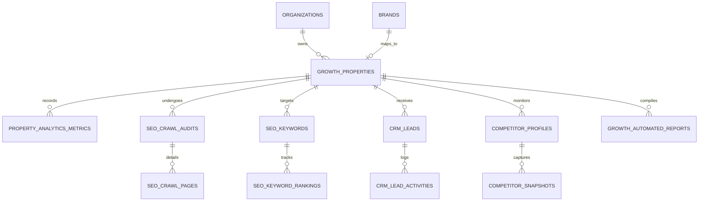

# POSTPILOT DATABASE IMPACT & SCHEMA EVOLUTION PLAN
**Phase 0 — Database Preservation & Expansion Specification**  
**Database Engines:** SQLite 3 (WAL Mode) & PostgreSQL 15/16  
**Primary Database File:** `D:\postpilot\data\posts.db`  
**Schema Version:** PostPilot Growth v2.0

---

## 1. Schema Preservation & Safety Mandate

1. **Zero-Downtime Additive Evolution:** All 25 existing tables, columns, indexes, foreign keys, and trigger constraints are preserved with 100% backward compatibility.
2. **Zero Modification to Existing Records:** Not a single existing row in `posts`, `scheduled_posts`, `brands`, `campaigns`, `content_drafts`, or `social_accounts` will be deleted, updated, or re-keyed.
3. **Dual Engine Portability:** Every new table and index is defined using portable DDL that executes identically on SQLite (for local development and Android Termux) and PostgreSQL (for production Linux VPS).
4. **Idempotent Migration Runner:** Schema additions are executed via idempotent `CREATE TABLE IF NOT EXISTS` and safe column existence checks in `database.py`, ensuring repeat runs never error.

---

## 2. Existing Baseline Schema Summary (Preserved 100%)

The following 25 tables remain untouched:
- `organizations`, `brands`, `brand_marketing_profiles`, `users`
- `posts`, `scheduled_posts`, `post_audit_logs`, `synced_posts`
- `campaigns`, `campaign_strategies`, `content_plans`, `content_plan_entries`, `content_drafts`, `content_draft_revisions`
- `media_assets`, `social_accounts`, `whatsapp_webhook_events`, `whatsapp_suppression_list`, `whatsapp_templates`
- `ai_usage_logs`, `subscription_plans`, `organization_subscriptions`
- `worker_leases`, `task_state`, `sqlite_sequence`

---

## 3. New Growth & Intelligence Schema Specifications



---

### 3.1 Table: `growth_properties`
*Manages the authoritative registry of the seven independent Gaatha properties.*

```sql
CREATE TABLE IF NOT EXISTS growth_properties (
    id INTEGER PRIMARY KEY AUTOINCREMENT,
    organization_id INTEGER NOT NULL,
    brand_id INTEGER,
    slug TEXT NOT NULL UNIQUE,
    display_name TEXT NOT NULL,
    canonical_url TEXT NOT NULL,
    property_type TEXT NOT NULL DEFAULT 'web', -- 'corporate', 'saas_product', 'subdomain', 'landing_page'
    ga4_property_id TEXT,
    ga4_measurement_id TEXT,
    gsc_site_url TEXT,
    bing_site_url TEXT,
    umami_website_id TEXT,
    sitemap_url TEXT,
    target_countries TEXT, -- Comma-separated or JSON list of ISO codes (e.g., 'IN,US,AE,GB,AL')
    primary_language TEXT DEFAULT 'en',
    is_active INTEGER NOT NULL DEFAULT 1,
    created_at TIMESTAMP DEFAULT CURRENT_TIMESTAMP,
    updated_at TIMESTAMP DEFAULT CURRENT_TIMESTAMP,
    FOREIGN KEY (organization_id) REFERENCES organizations(id) ON DELETE CASCADE,
    FOREIGN KEY (brand_id) REFERENCES brands(id) ON DELETE SET NULL
);

CREATE INDEX IF NOT EXISTS idx_growth_properties_org ON growth_properties(organization_id);
CREATE INDEX IF NOT EXISTS idx_growth_properties_slug ON growth_properties(slug);
```

---

### 3.2 Table: `property_analytics_metrics`
*Stores aggregated traffic and engagement telemetry synchronized from GA4, GSC, Bing, and Umami.*

```sql
CREATE TABLE IF NOT EXISTS property_analytics_metrics (
    id INTEGER PRIMARY KEY AUTOINCREMENT,
    organization_id INTEGER NOT NULL,
    property_id INTEGER NOT NULL,
    metric_date TEXT NOT NULL, -- Format: YYYY-MM-DD
    metric_source TEXT NOT NULL, -- 'ga4', 'gsc', 'umami', 'bing', 'blended'
    sessions INTEGER DEFAULT 0,
    users INTEGER DEFAULT 0,
    new_users INTEGER DEFAULT 0,
    pageviews INTEGER DEFAULT 0,
    bounce_rate REAL DEFAULT 0.0,
    avg_session_duration REAL DEFAULT 0.0,
    organic_clicks INTEGER DEFAULT 0,
    organic_impressions INTEGER DEFAULT 0,
    top_referrers_json TEXT, -- JSON array of [{source, sessions}]
    top_pages_json TEXT, -- JSON array of [{path, pageviews}]
    device_breakdown_json TEXT, -- JSON object {desktop, mobile, tablet}
    country_breakdown_json TEXT, -- JSON array of [{country, users}]
    synced_at TIMESTAMP DEFAULT CURRENT_TIMESTAMP,
    FOREIGN KEY (organization_id) REFERENCES organizations(id) ON DELETE CASCADE,
    FOREIGN KEY (property_id) REFERENCES growth_properties(id) ON DELETE CASCADE,
    UNIQUE(property_id, metric_date, metric_source)
);

CREATE INDEX IF NOT EXISTS idx_analytics_metrics_prop_date ON property_analytics_metrics(property_id, metric_date);
```

---

### 3.3 Tables: `seo_crawl_audits` & `seo_crawl_pages`
*Tracks technical crawl jobs and per-page audit findings for the Technical SEO Engine.*

```sql
CREATE TABLE IF NOT EXISTS seo_crawl_audits (
    id INTEGER PRIMARY KEY AUTOINCREMENT,
    organization_id INTEGER NOT NULL,
    property_id INTEGER NOT NULL,
    crawl_type TEXT NOT NULL DEFAULT 'scheduled', -- 'manual', 'scheduled', 'smoke'
    status TEXT NOT NULL DEFAULT 'pending', -- 'pending', 'crawling', 'completed', 'failed'
    pages_crawled INTEGER DEFAULT 0,
    pages_passed INTEGER DEFAULT 0,
    pages_failed INTEGER DEFAULT 0,
    overall_health_score INTEGER DEFAULT 0, -- 0 to 100
    critical_issues_count INTEGER DEFAULT 0,
    warnings_count INTEGER DEFAULT 0,
    error_message TEXT,
    started_at TIMESTAMP DEFAULT CURRENT_TIMESTAMP,
    completed_at TIMESTAMP,
    FOREIGN KEY (organization_id) REFERENCES organizations(id) ON DELETE CASCADE,
    FOREIGN KEY (property_id) REFERENCES growth_properties(id) ON DELETE CASCADE
);

CREATE TABLE IF NOT EXISTS seo_crawl_pages (
    id INTEGER PRIMARY KEY AUTOINCREMENT,
    audit_id INTEGER NOT NULL,
    property_id INTEGER NOT NULL,
    url TEXT NOT NULL,
    status_code INTEGER NOT NULL,
    response_time_ms INTEGER,
    title TEXT,
    title_length INTEGER,
    meta_description TEXT,
    meta_description_length INTEGER,
    h1 TEXT,
    canonical_url TEXT,
    is_indexable INTEGER DEFAULT 1,
    schema_types TEXT, -- Comma-separated Schema.org types found
    og_tags_present INTEGER DEFAULT 0,
    broken_links_count INTEGER DEFAULT 0,
    issues_json TEXT, -- JSON array of [{severity, rule, message}]
    crawled_at TIMESTAMP DEFAULT CURRENT_TIMESTAMP,
    FOREIGN KEY (audit_id) REFERENCES seo_crawl_audits(id) ON DELETE CASCADE,
    FOREIGN KEY (property_id) REFERENCES growth_properties(id) ON DELETE CASCADE
);

CREATE INDEX IF NOT EXISTS idx_seo_crawl_pages_audit ON seo_crawl_pages(audit_id);
CREATE INDEX IF NOT EXISTS idx_seo_crawl_pages_url ON seo_crawl_pages(property_id, url);
```

---

### 3.4 Tables: `seo_keywords` & `seo_keyword_rankings`
*Manages target keyword tracking and historical position monitoring from Search Console and SERP checks.*

```sql
CREATE TABLE IF NOT EXISTS seo_keywords (
    id INTEGER PRIMARY KEY AUTOINCREMENT,
    organization_id INTEGER NOT NULL,
    property_id INTEGER NOT NULL,
    keyword TEXT NOT NULL,
    target_url TEXT,
    target_country TEXT DEFAULT 'IN',
    search_intent TEXT DEFAULT 'informational', -- 'informational', 'commercial', 'transactional', 'navigational'
    current_position REAL,
    previous_position REAL,
    best_position REAL,
    monthly_search_volume INTEGER,
    is_tracked INTEGER NOT NULL DEFAULT 1,
    created_at TIMESTAMP DEFAULT CURRENT_TIMESTAMP,
    updated_at TIMESTAMP DEFAULT CURRENT_TIMESTAMP,
    FOREIGN KEY (organization_id) REFERENCES organizations(id) ON DELETE CASCADE,
    FOREIGN KEY (property_id) REFERENCES growth_properties(id) ON DELETE CASCADE,
    UNIQUE(property_id, keyword, target_country)
);

CREATE TABLE IF NOT EXISTS seo_keyword_rankings (
    id INTEGER PRIMARY KEY AUTOINCREMENT,
    keyword_id INTEGER NOT NULL,
    property_id INTEGER NOT NULL,
    check_date TEXT NOT NULL, -- Format: YYYY-MM-DD
    position REAL NOT NULL,
    clicks INTEGER DEFAULT 0,
    impressions INTEGER DEFAULT 0,
    ctr REAL DEFAULT 0.0,
    source TEXT DEFAULT 'gsc',
    recorded_at TIMESTAMP DEFAULT CURRENT_TIMESTAMP,
    FOREIGN KEY (keyword_id) REFERENCES seo_keywords(id) ON DELETE CASCADE,
    FOREIGN KEY (property_id) REFERENCES growth_properties(id) ON DELETE CASCADE,
    UNIQUE(keyword_id, check_date, source)
);

CREATE INDEX IF NOT EXISTS idx_seo_rankings_kw_date ON seo_keyword_rankings(keyword_id, check_date);
```

---

### 3.5 Tables: `crm_leads` & `crm_lead_activities`
*Centralizes inbound leads, contact requests, partner applications, and sales pipeline progression.*

```sql
CREATE TABLE IF NOT EXISTS crm_leads (
    id INTEGER PRIMARY KEY AUTOINCREMENT,
    organization_id INTEGER NOT NULL,
    property_id INTEGER NOT NULL,
    first_name TEXT NOT NULL,
    last_name TEXT,
    email TEXT NOT NULL,
    phone TEXT,
    company TEXT,
    country TEXT,
    source TEXT NOT NULL DEFAULT 'website_form', -- 'website_form', 'phoenix_inquiry', 'campaign', 'direct'
    source_url TEXT,
    campaign_id INTEGER,
    status TEXT NOT NULL DEFAULT 'open', -- 'open', 'contacted', 'qualified', 'unqualified', 'closed'
    stage TEXT NOT NULL DEFAULT 'lead', -- 'lead', 'prospect', 'meeting', 'negotiation', 'won', 'lost'
    deal_value INTEGER DEFAULT 0, -- Stored in whole currency units
    currency TEXT DEFAULT 'INR',
    assigned_to INTEGER, -- User ID
    notes TEXT,
    metadata_json TEXT, -- Arbitrary submission fields (e.g. visa type, pos register count)
    created_at TIMESTAMP DEFAULT CURRENT_TIMESTAMP,
    updated_at TIMESTAMP DEFAULT CURRENT_TIMESTAMP,
    FOREIGN KEY (organization_id) REFERENCES organizations(id) ON DELETE CASCADE,
    FOREIGN KEY (property_id) REFERENCES growth_properties(id) ON DELETE CASCADE,
    FOREIGN KEY (assigned_to) REFERENCES users(id) ON DELETE SET NULL
);

CREATE TABLE IF NOT EXISTS crm_lead_activities (
    id INTEGER PRIMARY KEY AUTOINCREMENT,
    lead_id INTEGER NOT NULL,
    activity_type TEXT NOT NULL, -- 'note', 'email', 'call', 'meeting', 'status_change', 'stage_change'
    title TEXT NOT NULL,
    description TEXT,
    performed_by INTEGER,
    created_at TIMESTAMP DEFAULT CURRENT_TIMESTAMP,
    FOREIGN KEY (lead_id) REFERENCES crm_leads(id) ON DELETE CASCADE,
    FOREIGN KEY (performed_by) REFERENCES users(id) ON DELETE SET NULL
);

CREATE INDEX IF NOT EXISTS idx_crm_leads_email ON crm_leads(property_id, email);
CREATE INDEX IF NOT EXISTS idx_crm_leads_status ON crm_leads(property_id, status, stage);
CREATE INDEX IF NOT EXISTS idx_crm_lead_activities_lead ON crm_lead_activities(lead_id);
```

---

### 3.6 Tables: `competitor_profiles` & `competitor_snapshots`
*Tracks competitors, domain metrics, content publishing velocity, and keyword gap opportunities.*

```sql
CREATE TABLE IF NOT EXISTS competitor_profiles (
    id INTEGER PRIMARY KEY AUTOINCREMENT,
    organization_id INTEGER NOT NULL,
    property_id INTEGER NOT NULL,
    name TEXT NOT NULL,
    domain TEXT NOT NULL,
    sitemap_url TEXT,
    social_links_json TEXT, -- JSON {twitter, linkedin, facebook, instagram}
    notes TEXT,
    is_active INTEGER NOT NULL DEFAULT 1,
    created_at TIMESTAMP DEFAULT CURRENT_TIMESTAMP,
    FOREIGN KEY (organization_id) REFERENCES organizations(id) ON DELETE CASCADE,
    FOREIGN KEY (property_id) REFERENCES growth_properties(id) ON DELETE CASCADE,
    UNIQUE(property_id, domain)
);

CREATE TABLE IF NOT EXISTS competitor_snapshots (
    id INTEGER PRIMARY KEY AUTOINCREMENT,
    competitor_id INTEGER NOT NULL,
    snapshot_date TEXT NOT NULL, -- Format: YYYY-MM-DD
    total_indexed_pages INTEGER,
    recent_articles_30d INTEGER,
    latest_article_title TEXT,
    latest_article_url TEXT,
    top_shared_keywords_json TEXT,
    notes TEXT,
    captured_at TIMESTAMP DEFAULT CURRENT_TIMESTAMP,
    FOREIGN KEY (competitor_id) REFERENCES competitor_profiles(id) ON DELETE CASCADE,
    UNIQUE(competitor_id, snapshot_date)
);

CREATE INDEX IF NOT EXISTS idx_competitor_snapshots_date ON competitor_snapshots(competitor_id, snapshot_date);
```

---

### 3.7 Table: `growth_automated_reports`
*Stores generated executive growth digests, technical audit summaries, and periodic PDF/HTML archives.*

```sql
CREATE TABLE IF NOT EXISTS growth_automated_reports (
    id INTEGER PRIMARY KEY AUTOINCREMENT,
    organization_id INTEGER NOT NULL,
    property_id INTEGER, -- Nullable for ecosystem-wide rollup reports
    report_type TEXT NOT NULL, -- 'weekly_digest', 'monthly_executive', 'seo_audit', 'lead_pipeline'
    period_start TEXT NOT NULL,
    period_end TEXT NOT NULL,
    title TEXT NOT NULL,
    summary_json TEXT, -- JSON KPI deltas {visitors_delta, clicks_delta, new_leads}
    html_content TEXT,
    created_by INTEGER,
    created_at TIMESTAMP DEFAULT CURRENT_TIMESTAMP,
    FOREIGN KEY (organization_id) REFERENCES organizations(id) ON DELETE CASCADE,
    FOREIGN KEY (property_id) REFERENCES growth_properties(id) ON DELETE CASCADE
);

CREATE INDEX IF NOT EXISTS idx_growth_reports_org_type ON growth_automated_reports(organization_id, report_type);
```

---

## 4. Minor Additive Enhancements to Existing Tables

To link the SEO Content Studio cleanly with the existing drafts engine, the following non-breaking columns will be added to `content_drafts` via safe column existence checks:

```sql
-- Executed only if column does not already exist
ALTER TABLE content_drafts ADD COLUMN seo_keyword TEXT;
ALTER TABLE content_drafts ADD COLUMN meta_title TEXT;
ALTER TABLE content_drafts ADD COLUMN meta_description TEXT;
ALTER TABLE content_drafts ADD COLUMN canonical_url TEXT;
ALTER TABLE content_drafts ADD COLUMN schema_markup_json TEXT;
```

---

## 5. Migration Execution Strategy & Rollback Safety

- **Execution Hook:** Migrations are wrapped inside `init_growth_schema()` in `database.py`, called during `init_db()`.
- **Pre-execution Verification:** The migration script verifies SQLite `PRAGMA integrity_check` before applying changes.
- **Rollback Procedure:** In the unlikely event of migration failure, the pristine backup snapshot at `D:\postpilot\safety-backup-20261114-053448\data\posts.db` can be restored in under 5 seconds.

