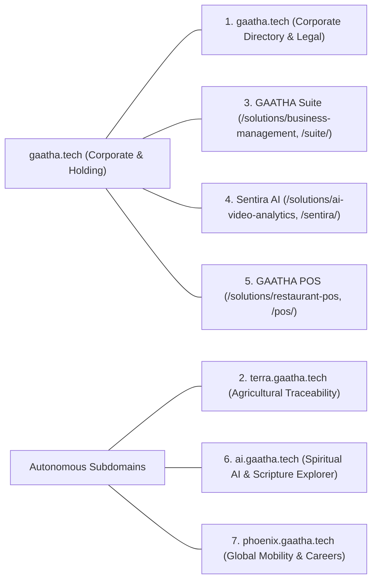

# POSTPILOT GROWTH & INTELLIGENCE COMMAND CENTER
## Target Architecture Specification & System Blueprint
**Phase 0 — Architectural Assessment & Foundation Design**  
**Project:** PostPilot  
**Repository:** `https://github.com/gaathaaidni/postpilot`  
**Current Baseline Commit:** `ede77a2`

---

## 1. Architectural Vision & Guiding Principles

The objective of the PostPilot Growth & Intelligence initiative is to evolve PostPilot from a specialized social media publishing tool into an all-in-one **Growth & Intelligence Command Center** for the entire Gaatha digital ecosystem.

### Guiding Principles:
1. **Zero Disruption to Existing Operations:** The active social publishing pipelines (Facebook, Instagram, LinkedIn, WhatsApp Cloud API), marketing campaign workflows, AI generation guardrails, two-man approval desk, and background workers must remain 100% operational and undisturbed.
2. **Single Application Paradigm:** Avoid introducing secondary microservices, Node.js sidecars, or separate web applications. The Growth & Intelligence capabilities will be natively integrated into PostPilot's proven Flask backend, Jinja2/vanilla JS SPA frontend, and SQLite/PostgreSQL database abstraction.
3. **Multi-Tenant & Multi-Property Hierarchy:** Support an authoritative Seven Property Registry where each Gaatha platform or product is configured, monitored, and analyzed independently, while rolling up into executive ecosystem-wide intelligence.
4. **Strictly Read-Only External Integrations:** All analytics, search console, and webmaster adapters will request and enforce strictly read-only permissions (`analytics.readonly`, `webmasters.readonly`).
5. **Fail-Closed Guardrails Preserved:** Live publishing and campaign dispatches remain locked down behind `POSTPILOT_PUBLISHING_ENABLED=0` and platform-specific feature flags.

```mermaid
flowchart TD
    subgraph PostPilot_Core ["PostPilot Growth & Intelligence Command Center"]
        UI["Unified Web UI (Jinja2 / Vanilla JS SPA)"]
        API["Flask REST API Engine (app.py)"]
        
        subgraph Modules ["Growth Modules"]
            M1["1. Growth Command Center"]
            M2["2. Brand & Property Registry"]
            M3["3. Website Analytics Hub"]
            M4["4. SEO Intelligence & Audit"]
            M5["5. SEO Content Studio"]
            M6["6. Lead CRM Pipeline"]
            M7["7. Competitor Intelligence"]
            M8["8. Reports & Automation"]
        end
        
        subgraph Core_Engines ["Preserved Core Engines"]
            PUB["Social Publishing Engine (FB/IG/LI/WA)"]
            MKT["Marketing Campaign Studio"]
            AI["AI Inference Engine (Groq/OpenAI)"]
            WRK["Worker & Task Queue (worker.py)"]
        end
        
        DB[("Dual Database Layer (SQLite WAL / PostgreSQL)")]
    end
    
    subgraph External_Integrations ["External Integrations & Data Sources"]
        GA4["Google Analytics 4 Data API"]
        GSC["Google Search Console API"]
        BING["Bing Webmaster Tools API"]
        FPA["First-Party Analytics (Umami / PostHog)"]
        CRAWL["Async Technical SEO Crawler"]
        META["Meta Graph API (FB/IG/WA)"]
        LI_API["LinkedIn v2 Community API"]
    end
    
    UI --> API
    API --> Modules
    API --> Core_Engines
    Modules --> DB
    Core_Engines --> DB
    
    M3 --> GA4
    M3 --> GSC
    M3 --> BING
    M3 --> FPA
    M4 --> CRAWL
    PUB --> META
    PUB --> LI_API
```

---

## 2. Seven Property Registry Architecture

The Gaatha digital ecosystem encompasses seven distinct commercial, operational, and intellectual properties. The Brand Registry will be extended into an authoritative **Property Registry**, allowing individual properties to maintain independent analytics streams, SEO targets, sitemaps, and lead funnels.

### Independent Property Topology:

| Property ID | Property Name | Canonical Domain / Path | Target Focus | Analytics Stream | Search Console Sitemap | CRM Pipeline Tag |
|---|---|---|---|---|---|---|
| `prop_gaatha_corp` | **GAATHA Corporate** | `https://gaatha.tech` | Holding company, executive leadership, legal notice, cross-border corporate governance | GA4 Stream: Apex Corporate | `https://gaatha.tech/sitemap.xml` | `gaatha_corporate` |
| `prop_terra` | **GAATHA Terra** | `https://terra.gaatha.tech` | Agricultural supply chain traceability, provenance, multi-tenant farm lots | GA4 Stream: Terra Web | `https://terra.gaatha.tech/sitemap.xml` | `terra_traceability` |
| `prop_suite` | **GAATHA Suite** | `https://gaatha.tech/solutions/business-management` (`/suite/`) | Cloud ERP, financial accounting, invoicing, CRM, inventory & HR payroll | GA4 Stream: Suite Product | `https://gaatha.tech/sitemap.xml#suite` | `suite_erp` |
| `prop_sentira` | **Sentira AI** | `https://gaatha.tech/solutions/ai-video-analytics` (`/sentira/`) | Visual AI, low-latency RTSP/HLS camera ingestion, perimeter event security | GA4 Stream: Sentira Product | `https://gaatha.tech/sitemap.xml#sentira` | `sentira_vision` |
| `prop_pos` | **GAATHA POS** | `https://gaatha.tech/solutions/restaurant-pos` (`/pos/`) | High-speed restaurant & retail point-of-sale, live KDS, recipe stock deduction | GA4 Stream: POS Product | `https://gaatha.tech/sitemap.xml#pos` | `pos_retail` |
| `prop_ai` | **GAATHA AI** | `https://ai.gaatha.tech` | Spiritual intelligence, classical scripture explorer, Vedic RAG search, multi-turn chat | GA4 Stream: Gaatha AI Web | `https://ai.gaatha.tech/sitemap.xml` | `gaatha_ai` |
| `prop_phoenix` | **Phoenix Mobility** | `https://phoenix.gaatha.tech` | Cross-border immigration, career placement, residency programs, consultant desk | GA4 Stream: Phoenix Platform | `https://phoenix.gaatha.tech/sitemap.xml` | `phoenix_mobility` |

> [!IMPORTANT]
> **Subpath Product Isolation on `gaatha.tech`:**  
> The corporate site (`gaatha.tech`) serves the corporate holding pages (`/`, `/about`, `/leadership`, `/contact`, `/blog`) while also reverse-proxying product subpaths (`/suite/`, `/pos/`, `/sentira/`) and product solution landing pages (`/solutions/...`).  
> The Property Registry allows GAATHA Suite, Sentira AI, and GAATHA POS to be configured **independently** from the corporate homepage, with discrete keyword baskets, lead funnels, and analytics filters.  
> **PostPilot remains strictly separate** as an internal administrative engine on `postpilot.gaatha.tech`.

---

## 3. Detailed Module Specifications

### Module 1: Growth Command Center
- **Objective:** Executive single-pane-of-glass dashboard providing consolidated ecosystem intelligence across all 7 properties.
- **Existing Components Reused:**
  - `templates/index.html` navigation framework, UI themes, and CSS custom properties.
  - Organization and tenant resolution in `app.py`.
  - Database connection helpers in `database.py`.
- **New Components Required:**
  - `growth_service.py`: High-level metrics aggregation service (combining traffic, SEO health, lead counts, and content volume).
  - UI View: `#growth-command-pane` with property filtering, KPI cards (Total Visitors, Organic Search Clicks, Active Leads, Published Content), and trend charts.
- **Database Changes:** Reuses rollup queries against new growth tables; no isolated schema needed.
- **API Endpoints:**
  - `GET /api/growth/dashboard`: Returns consolidated ecosystem-wide growth metrics.
  - `GET /api/growth/properties/<property_id>/overview`: Returns single-property drilldown metrics.
- **Permission Requirements:** `login_required` (role: `admin`, `editor`, `viewer`).
- **Testing Requirements:** Unit tests for metric aggregation and tenant property isolation.
- **Risks & Dependencies:** Dependent on upstream analytics and crawler data syncs. Graceful zero-state handling required when third-party APIs are disconnected.

---

### Module 2: Brand & Property Registry
- **Objective:** Manage property metadata, domain bindings, tracking IDs (GA4 Measurement IDs, GSC Site URLs, Bing Site IDs), target geographies, brand voice, and sitemap URLs.
- **Existing Components Reused:**
  - Existing `brands` table (ID 1-6 map directly to the Gaatha products).
  - Existing `brand_marketing_profiles` table (voice, positioning, audience, guidelines).
  - `/api/brands` CRUD endpoints in `app.py`.
- **New Components Required:**
  - New database table `growth_properties` linked to `brands`.
  - Property configuration UI modal in the settings tab.
- **Database Changes:**
  - Create table `growth_properties` (columns: `id`, `organization_id`, `brand_id`, `slug`, `display_name`, `canonical_url`, `property_type`, `ga4_property_id`, `ga4_measurement_id`, `gsc_site_url`, `bing_site_url`, `umami_website_id`, `sitemap_url`, `target_countries`, `is_active`, `created_at`, `updated_at`).
- **API Endpoints:**
  - `GET /api/growth/properties`: List registered properties with connectivity status.
  - `POST /api/growth/properties`: Register a new property.
  - `GET /api/growth/properties/<property_id>`: Retrieve property configuration.
  - `PUT /api/growth/properties/<property_id>`: Update tracking keys and URLs.
- **Permission Requirements:** `login_required` (role: `admin`).
- **Testing Requirements:** Validation tests for valid URL formats, tracking ID formats (e.g. `G-[A-Z0-9]+`), and tenant isolation.
- **Risks & Dependencies:** None. Standard CRUD operation.

---

### Module 3: Website Analytics Hub
- **Objective:** Aggregate multi-source traffic intelligence: Google Analytics 4 (GA4 Data API), Google Search Console (GSC API), Bing Webmaster Tools, and first-party privacy analytics (Umami/PostHog).
- **Existing Components Reused:**
  - `config.py` environment and credential loading patterns.
  - `ai_usage_logs` telemetry structure pattern for daily metric snapshots.
- **New Components Required:**
  - `analytics_adapters/`:
    - `ga4_adapter.py`: Google Analytics Data API v1beta client.
    - `gsc_adapter.py`: Google Search Console Search Analytics client.
    - `bing_adapter.py`: Bing Webmaster API client.
    - `umami_adapter.py`: Umami Cloud / Self-hosted REST API client.
  - Table `property_analytics_metrics`: Persistent daily/hourly rollups.
- **Database Changes:**
  - Create table `property_analytics_metrics` (`id`, `property_id`, `date`, `metric_source`, `sessions`, `users`, `new_users`, `pageviews`, `bounce_rate`, `avg_session_duration`, `organic_clicks`, `organic_impressions`, `top_referrers_json`, `top_pages_json`, `device_breakdown_json`, `country_breakdown_json`, `synced_at`).
- **API Endpoints:**
  - `GET /api/growth/analytics/<property_id>/traffic`: Historical traffic time-series (visitors, page views, sessions).
  - `GET /api/growth/analytics/<property_id>/sources`: Traffic acquisition channels and referrers.
  - `GET /api/growth/analytics/<property_id>/geo`: Geographic distribution of visitors.
  - `POST /api/growth/analytics/<property_id>/sync`: Trigger manual background telemetry synchronization.
- **Permission Requirements:** `login_required` (read: all roles; sync: `admin`).
- **Testing Requirements:** Mock API responses for GA4, GSC, and Umami; verification of timezone alignment (UTC vs. Asia/Kolkata).
- **Risks & Dependencies:** Upstream Google/Bing API quotas and rate limits. Mitigation: cache daily snapshots in SQLite; never make live synchronous API requests during dashboard page load.

---

### Module 4: SEO Intelligence & Technical Audit Engine
- **Objective:** Autonomous technical crawler that scans the 7 properties to verify HTTP response codes, title tags, meta descriptions, canonical URLs, robots.txt directives, XML sitemaps, Open Graph tags, Schema.org JSON-LD, broken links, and mobile viewport readiness.
- **Existing Components Reused:**
  - `worker.py` background execution thread and lease management.
  - `task_state` table for tracking crawl job status and intervals.
- **New Components Required:**
  - `seo_crawler.py`: Async, respectful HTTP crawler (`urllib.request` / `BeautifulSoup4`) with rate limiting (max 2 requests/sec per domain) and robots.txt compliance.
  - Tables `seo_crawl_audits` and `seo_crawl_pages`.
  - SEO Health Score calculation engine (0–100 scale based on weighted technical criteria).
- **Database Changes:**
  - Create table `seo_crawl_audits` (`id`, `property_id`, `crawl_type`, `started_at`, `completed_at`, `status`, `pages_crawled`, `pages_passed`, `pages_failed`, `overall_health_score`, `critical_issues_count`, `warnings_count`).
  - Create table `seo_crawl_pages` (`id`, `audit_id`, `property_id`, `url`, `status_code`, `response_time_ms`, `title`, `meta_description`, `h1`, `canonical_url`, `is_indexable`, `schema_types`, `og_tags_present`, `broken_links_count`, `issues_json`).
- **API Endpoints:**
  - `POST /api/growth/seo/<property_id>/crawl`: Trigger asynchronous technical SEO crawl.
  - `GET /api/growth/seo/<property_id>/audits`: List historical crawl audits and health trends.
  - `GET /api/growth/seo/audits/<audit_id>`: Detailed audit results with issues list and export.
- **Permission Requirements:** `login_required` (role: `admin`, `editor`).
- **Testing Requirements:** Synthetic HTML fixture crawling; verification that rate limiters prevent denial-of-service on local and production properties.
- **Risks & Dependencies:** Accidental overloading of target production websites. Mitigation: hard-coded polite delays (500ms minimum delay between requests), concurrency cap = 1, maximum depth = 3 levels, max pages per crawl = 100.

---

### Module 5: SEO Content Studio
- **Objective:** Supercharge PostPilot's existing AI drafting engine to research keyword search intent, generate structured blog articles, formulate high-CTR meta tags, and build Schema.org JSON-LD structured data.
- **Existing Components Reused:**
  - `ai_service.py` multi-provider architecture (Groq / OpenAI / Mock).
  - `content_drafts` and `content_draft_revisions` tables.
  - Existing token budgeting and cost controls in `ai_usage_logs`.
- **New Components Required:**
  - SEO prompt builder extensions in `ai_service.py` (`build_seo_article_prompts`, `build_metadata_prompts`, `build_schema_jsonld_prompts`).
  - Content Studio UI extension supporting article preview with rendered Markdown and copy-ready HTML.
- **Database Changes:**
  - Alter table `content_drafts` to add optional columns: `seo_keyword`, `meta_title`, `meta_description`, `canonical_url`, `schema_markup_json`.
- **API Endpoints:**
  - `POST /api/growth/seo/generate-article`: Generate complete SEO article from target keyword and property positioning.
  - `POST /api/growth/seo/generate-metadata`: Generate optimized meta titles, descriptions, and JSON-LD schema.
- **Permission Requirements:** `login_required` (role: `admin`, `editor`).
- **Testing Requirements:** Verification that generated JSON-LD strictly conforms to Schema.org standards (Article, Organization, SoftwareApplication).
- **Risks & Dependencies:** AI hallucinations of factual product features. Mitigation: inject `approved_product_facts` and `prohibited_claims` from `brand_marketing_profiles` into system prompts.

---

### Module 6: Lead CRM Pipeline
- **Objective:** Centralize inbound leads, contact requests, and demo inquiries originating across the ecosystem (e.g. `phoenix.gaatha.tech` partner desk, `gaatha.tech` contact forms) into an actionable sales pipeline.
- **Existing Components Reused:**
  - Multi-tenant security filters in `database.py`.
  - Notification mechanisms in `worker.py`.
- **New Components Required:**
  - `crm_service.py`: Inbound lead processing, deduplication, and pipeline stage transitions (`new`, `contacted`, `qualified`, `proposal`, `closed_won`, `closed_lost`).
  - Tables `crm_leads` and `crm_lead_activities`.
  - Lead desk UI with search, stage filtering, and activity logging.
  - Inbound webhook endpoint with HMAC validation for external form integration.
- **Database Changes:**
  - Create table `crm_leads` (`id`, `organization_id`, `property_id`, `first_name`, `last_name`, `email`, `phone`, `company`, `source`, `source_url`, `status`, `stage`, `estimated_value`, `assigned_to`, `notes`, `created_at`, `updated_at`).
  - Create table `crm_lead_activities` (`id`, `lead_id`, `activity_type`, `title`, `description`, `performed_by`, `created_at`).
- **API Endpoints:**
  - `GET /api/growth/crm/leads`: List and filter leads.
  - `POST /api/growth/crm/leads`: Create lead manually.
  - `PUT /api/growth/crm/leads/<lead_id>`: Update lead status, stage, or assignment.
  - `POST /api/growth/crm/leads/<lead_id>/activities`: Log phone call, meeting, or email note.
  - `POST /api/webhooks/leads`: Public inbound webhook for verified website forms.
- **Permission Requirements:** `login_required` (role: `admin`, `editor`).
- **Testing Requirements:** Lead deduplication by email/phone; tenant boundary enforcement; webhook signature verification.
- **Risks & Dependencies:** Inbound spam form submissions. Mitigation: honeypot fields, rate limiting, and email MX record verification.

---

### Module 7: Competitor Intelligence
- **Objective:** Monitor competitors across the 7 product sectors, tracking their published content velocity, social presence, estimated search visibility, and keyword rankings.
- **Existing Components Reused:**
  - Background task scheduling loops in `worker.py`.
- **New Components Required:**
  - `competitor_service.py`: Lightweight public web scrapper inspecting competitor sitemaps, homepage meta tags, and public social feeds.
  - Tables `competitor_profiles` and `competitor_snapshots`.
- **Database Changes:**
  - Create table `competitor_profiles` (`id`, `organization_id`, `property_id`, `name`, `domain`, `sitemap_url`, `social_links_json`, `is_active`, `created_at`).
  - Create table `competitor_snapshots` (`id`, `competitor_id`, `snapshot_date`, `estimated_organic_keywords`, `estimated_traffic`, `recent_articles_count`, `latest_article_title`, `latest_article_url`, `observed_changes_json`).
- **API Endpoints:**
  - `GET /api/growth/competitors`: List competitors by property.
  - `POST /api/growth/competitors`: Add competitor domain to monitor.
  - `GET /api/growth/competitors/<competitor_id>/history`: Retrieve historical competitor metrics.
- **Permission Requirements:** `login_required` (role: `admin`).
- **Testing Requirements:** Handling competitor site downtime, 403 blocks, or missing sitemaps gracefully without throwing unhandled exceptions.
- **Risks & Dependencies:** Anti-bot blocks by competitor servers. Mitigation: fail-soft error catching, zero-aggression user agent (`PostPilot-Growth-Bot/1.0`), and long polling intervals (e.g. weekly).

---

### Module 8: Reports & Automation Engine
- **Objective:** Automate periodic data collection, technical health checks, and executive digest generation (weekly/monthly PDF/HTML growth summaries).
- **Existing Components Reused:**
  - `worker.py` master loop and `worker_leases`.
  - `backup.py` export and packaging infrastructure.
- **New Components Required:**
  - `reporting_service.py`: Assembles weekly growth digests combining traffic deltas, SEO scores, new leads, and social publish metrics into clean HTML/PDF reports.
  - Table `growth_automated_reports`.
- **Database Changes:**
  - Create table `growth_automated_reports` (`id`, `organization_id`, `property_id`, `report_type`, `period_start`, `period_end`, `title`, `summary_json`, `html_content`, `created_at`).
- **API Endpoints:**
  - `GET /api/growth/reports`: List generated executive reports.
  - `POST /api/growth/reports/generate`: On-demand report compilation.
  - `GET /api/growth/reports/<report_id>/download`: Download formatted HTML/PDF report.
- **Permission Requirements:** `login_required` (role: `admin`, `editor`, `viewer`).
- **Testing Requirements:** Verifying date boundary arithmetic across monthly and weekly periods.
- **Risks & Dependencies:** None. Self-contained data synthesis.

