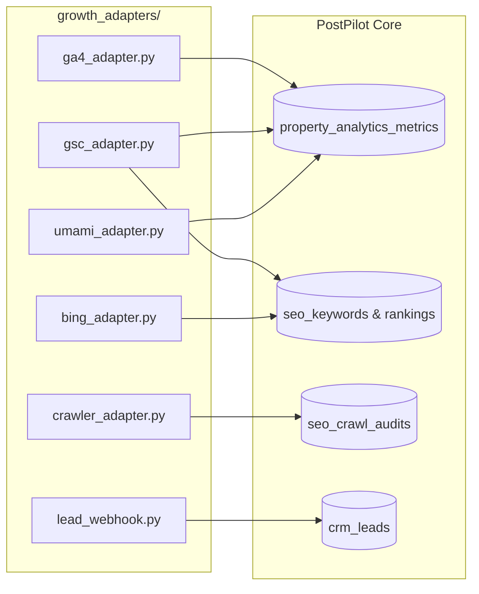

# POSTPILOT INTEGRATION MATRIX & ADAPTER SPECIFICATIONS
**Phase 0 — Third-Party & Ecosystem Adapter Architecture**  
**Security Standard:** Strictly Read-Only (Zero Superfluous Permissions)  
**Host Framework:** Python 3.12 / Flask

---

## 1. Integration Landscape Overview

To power the Growth & Intelligence Command Center across all 7 Gaatha properties, PostPilot requires reliable, read-only ingestion pipelines. Each integration is implemented as an autonomous adapter module residing in `growth_adapters/`, following PostPilot's unified `BasePlatformAdapter` design pattern.



---

## 2. Adapter Deep-Dive Specifications

### 2.1 Google Analytics 4 (GA4) Data API
- **API Version:** Google Analytics Data API v1beta (`google-analytics-data`)
- **Primary Use Case:** Historical & real-time sessions, active users, new users, page views, bounce rates, average engagement duration, top referrers, device breakdown, and geographic country distribution.
- **Authorization Protocol:** Google Cloud Service Account with JSON credentials.
- **Enforced Scope:** `https://www.googleapis.com/auth/analytics.readonly` (Strictly Read-Only).
- **Credentials Storage:** Service account JSON path stored in `GA4_CREDENTIALS_FILE` or encrypted in `growth_properties.ga4_credentials_encrypted`.
- **API Request Dimensions:** `date`, `sessionDefaultChannelGroup`, `pagePath`, `deviceCategory`, `country`.
- **API Request Metrics:** `sessions`, `totalUsers`, `newUsers`, `screenPageViews`, `bounceRate`, `averageSessionDuration`.
- **Sync Frequency:** Once daily (02:00 IST) for finalized previous-day metrics; on-demand refresh for current day.
- **Quotas & Limits:** Standard free tier allows 25,000 tokens per project per day. Daily batching requires < 100 tokens per day.
- **Failure Mode & Fallbacks:** If API rate-limited or token invalid, returns cached snapshot from `property_analytics_metrics`. Dashboard displays non-blocking "Cached Telemetry" badge.

---

### 2.2 Google Search Console (GSC) API
- **API Version:** Google Webmasters API v3 / Search Console API v1
- **Primary Use Case:** Organic search impressions, search clicks, average click-through rate (CTR), average SERP ranking position, and query-level keyword tracking per property.
- **Authorization Protocol:** Google Cloud Service Account added as "Restricted" (Read-Only) user in Search Console property settings.
- **Enforced Scope:** `https://www.googleapis.com/auth/webmasters.readonly` (Strictly Read-Only).
- **Credentials Storage:** Shared with GA4 service account or dedicated GSC service key.
- **Query Aggregation:** Dimensions: `date`, `query`, `page`, `country`, `device`. Search type: `web`.
- **Sync Frequency:** Daily batch sync (Google Search Console data has a 48-hour latency window).
- **Quotas & Limits:** 1,200 requests per minute per project.
- **Failure Mode & Fallbacks:** Graceful fallback to previous day's rankings; flags unverified property domains in the UI.

---

### 2.3 Bing Webmaster Tools API
- **API Version:** Bing Webmaster API v2 (JSON REST)
- **Primary Use Case:** Bing organic search impressions, clicks, crawled pages, crawl errors, and Bing keyword position telemetry.
- **Authorization Protocol:** Bing Webmaster API Key or OAuth 2.0.
- **Endpoint:** `https://ssl.bing.com/webmaster/api.svc/json/GetRankAndTrafficStats?siteUrl={siteUrl}&apiKey={apiKey}`
- **Enforced Scope:** Read-Only API access token.
- **Credentials Storage:** Environment variable `BING_WEBMASTER_API_KEY` or per-property override.
- **Sync Frequency:** Weekly or bi-weekly sync.
- **Failure Mode & Fallbacks:** If API key unconfigured, Bing metrics display as "Not Connected" without interrupting other modules.

---

### 2.4 Privacy-Friendly First-Party Analytics Evaluation: Umami vs. PostHog

To provide continuous, privacy-compliant, cookieless analytics across the European jurisdiction of **GAATHA Ventures Sh.P.K. (Albania)** and Indian properties under **Aidni Global LLP**, we evaluated the two leading privacy-focused analytics engines:

| Feature / Criterion | Umami (Self-Hosted / Cloud) | PostHog (Open-Source / Cloud) | PostPilot Verdict |
|---|---|---|---|
| **Cookie Requirement** | **100% Cookieless** (No consent banner needed) | Cookies / LocalStorage by default | **Umami wins** (Zero GDPR friction) |
| **Data Ownership** | Own PostgreSQL / MySQL database | Own ClickHouse / PostgreSQL stack | **Umami wins** (Extremely lightweight) |
| **Server Resource Overhead** | < 150 MB RAM, ultra-lightweight Node/Docker | 4 GB+ RAM, complex ClickHouse cluster | **Umami wins** (Runs easily on current VPS) |
| **API Scripting Simplicity** | Clean REST API (`/api/websites/{id}/stats`) | Complex query language (HogQL) | **Umami wins** (Trivial python adapter) |
| **Feature Focus** | Page views, referrers, devices, countries | Product analytics, session replays, feature flags | **PostHog** has more features, but excessive for simple traffic audit |
| **Compliance Alignment** | Fully compliant with EU GDPR & Albania NIPT rules | Requires cookie banner for tracking | **Umami** directly matches Gaatha needs |

**Recommendation:**  
Adopt **Umami** as the primary first-party privacy analytics adapter (`umami_adapter.py`). It connects via standard REST API (`GET /api/websites/{id}/stats?startAt={start}&endAt={end}`) using a read-only API token.

---

### 2.5 Technical SEO Crawler & Sitemaps Auditor
- **Implementation:** Native Python asynchronous HTTP inspection module (`urllib.request`, `http.client`, `BeautifulSoup4`).
- **Primary Use Case:** Crawling internal pages of the 7 properties to verify HTTP response codes, title tags, meta descriptions, canonical URLs, robots.txt directives, XML sitemaps, Open Graph tags, Schema.org JSON-LD, broken links, and mobile viewport readiness.
- **Crawling Safeguards:**
  - Strict maximum depth limit: 3 levels.
  - Strict page ceiling per crawl: 100 pages.
  - Concurrency limit: 1 request at a time per host.
  - Polite crawl delay: 500ms between requests.
  - User Agent: `PostPilot-Growth-Bot/1.0 (+https://postpilot.gaatha.tech; read-only technical audit)`
  - Respects `robots.txt` directives and `Disallow` rules.
- **Failure Mode & Fallbacks:** Timeout threshold set to 10 seconds per page. Network failures logged as critical audit issues without crashing the crawler worker.

---

### 2.6 Social Analytics Integrations (Preserved & Unified)
- **Meta Graph API (Facebook & Instagram):**
  - Reads published post engagement metrics (impressions, reach, likes, comments, shares) via `GET /{post_id}/insights`.
  - Reuses existing verified Meta tokens in `social_accounts`.
- **LinkedIn Community API:**
  - Reads share statistics via `GET /organizationalEntityShareStatistics?q=organizationalEntity&organizationalEntity={org_urn}`.
- **WhatsApp Cloud API:**
  - Inbound webhook processing in `app.py` (`/api/webhooks/whatsapp`) already captures delivery receipts (`sent`, `delivered`, `read`, `failed`).
  - Summarizes delivery rate percentages per template.

---

### 2.7 Inbound Lead CRM Webhook
- **Protocol:** HTTP POST to `/api/webhooks/leads`.
- **Payload Format:**
  ```json
  {
    "property_slug": "phoenix",
    "first_name": "Kishan",
    "last_name": "Patel",
    "email": "kishan@example.com",
    "phone": "+919825000000",
    "company": "Kishan Travels",
    "source": "partner_desk",
    "notes": "Interested in B2B immigration agent partnership",
    "metadata": {
      "preferred_destination": "Portugal",
      "applicant_type": "consultant"
    }
  }
  ```
- **Security:** Validated via HMAC-SHA256 signature in `X-PostPilot-Signature` header using shared secret `LEAD_WEBHOOK_SECRET`.
- **Deduplication:** Automatic matching against existing `crm_leads` by `(property_id, email)`. If existing lead found, appends activity note instead of creating duplicate.

