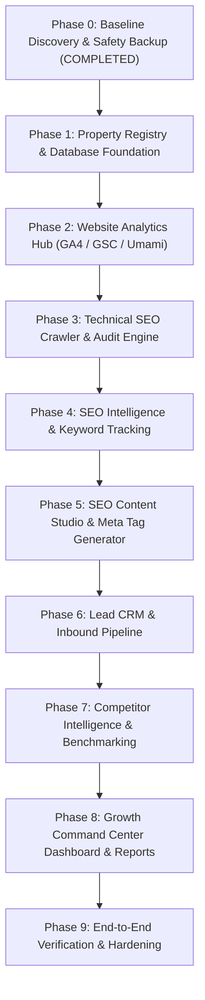

# POSTPILOT GROWTH & INTELLIGENCE — PHASE ROADMAP
**Master Implementation Sequence & Acceptance Gating**  
**Project:** PostPilot Growth & Intelligence Command Center  
**Repository:** `https://github.com/gaathaaidni/postpilot`  
**Current State:** Phase 0 Completed | Awaiting User Approval to Begin Phase 1

---

## 1. Phased Implementation Roadmap

---

### Phase 0: Baseline Discovery, Architecture Validation & Local Safety
- **Status:** **COMPLETED (November 14, 2026)**
- **Objectives:**
  - Audit existing frontend, backend, database, social publishing, AI, worker, and security layers.
  - Verify zero-disruption constraints on all live social channels (Facebook, Instagram, LinkedIn, WhatsApp).
  - Execute safe online SQLite database backup (`posts.db`) and portable archive export.
  - Create the 7 foundational architecture, database, integration, and security specifications.
- **Key Deliverables:**
  - `POSTPILOT_CURRENT_STATE_AUDIT.md`
  - `POSTPILOT_LOCAL_BACKUP_REPORT.md`
  - `POSTPILOT_GROWTH_ARCHITECTURE.md`
  - `POSTPILOT_DATABASE_IMPACT_PLAN.md`
  - `POSTPILOT_INTEGRATION_MATRIX.md`
  - `POSTPILOT_SECURITY_PLAN.md`
  - `POSTPILOT_PHASE_ROADMAP.md`
- **Gating Criteria:** Baseline backups verified; git working tree clean; test suite categorized; strict read-only boundary respected.

---

### Phase 1: Property Registry & Database Foundation
- **Objectives:**
  - Implement the additive schema migrations in `database.py` without touching existing tables.
  - Populate the Seven Property Registry (`growth_properties` table):
    1. `gaatha.tech` (GAATHA Corporate Apex)
    2. `terra.gaatha.tech` (GAATHA Terra)
    3. GAATHA Suite (`/solutions/business-management` & `/suite/`)
    4. Sentira AI (`/solutions/ai-video-analytics` & `/sentira/`)
    5. GAATHA POS (`/solutions/restaurant-pos` & `/pos/`)
    6. `ai.gaatha.tech` (GAATHA AI)
    7. `phoenix.gaatha.tech` (Phoenix Mobility)
  - Create property configuration CRUD API endpoints (`/api/growth/properties`).
- **Components to Reuse:** `database.py` query helpers, existing `brands` mappings, session tenant resolution.
- **New Components:** `database.py` growth schema runner, `growth_properties` CRUD in `app.py`.
- **Gating Criteria:** All 7 properties initialized and verified via API; existing 305 tests continue to pass; database integrity check returns `ok`.

---

### Phase 2: Website Analytics Hub (GA4, GSC & Umami)
- **Objectives:**
  - Implement read-only analytics adapters: `ga4_adapter.py`, `gsc_adapter.py`, `umami_adapter.py`.
  - Ingest traffic metrics (sessions, unique users, page views, organic clicks) into `property_analytics_metrics`.
  - Build UI traffic charts and source attribution breakdowns per property.
- **Components to Reuse:** `config.py` environment loading, Dark/Light dashboard UI cards.
- **New Components:** `growth_adapters/ga4_adapter.py`, `growth_adapters/gsc_adapter.py`, `growth_adapters/umami_adapter.py`, analytics API endpoints.
- **Gating Criteria:** Zero rate-limit violations; cached fallback verified when external APIs are offline; read-only scopes strictly validated.

---

### Phase 3: Technical SEO Crawler & Audit Engine
- **Objectives:**
  - Build the asynchronous, polite technical crawler (`seo_crawler.py`).
  - Scan target properties for HTTP status codes, title/meta tags, canonicals, H1 structure, JSON-LD schema, broken links, and robots.txt.
  - Compute normalized 0–100 SEO Technical Health Scores and store results in `seo_crawl_audits` and `seo_crawl_pages`.
  - Surface audit findings and actionable fix recommendations in the UI.
- **Components to Reuse:** `worker.py` thread queue and leases; `task_state` intervals.
- **New Components:** `seo_crawler.py`, crawl trigger API, crawl audit view in dashboard.
- **Gating Criteria:** SSRF protections proven; concurrency capped at 1 request per host with 500ms sleep; zero impact on target site availability.

---

### Phase 4: SEO Intelligence & Keyword Tracking
- **Objectives:**
  - Implement target keyword tracking and historical position monitoring via Google Search Console and Bing Webmasters.
  - Track clicks, impressions, CTR, and average SERP rankings over time.
  - Highlight ranking gains, drops, and keyword cannibalization risks.
- **Components to Reuse:** GSC adapter from Phase 2; existing calendar/timeline graphing components.
- **New Components:** Keyword tracker service, `seo_keywords` and `seo_keyword_rankings` CRUD endpoints.
- **Gating Criteria:** Multi-country filtering functional (India, US, UK, UAE); ranking history charts render cleanly.

---

### Phase 5: SEO Content Studio & Meta Tag Generator
- **Objectives:**
  - Extend PostPilot's existing Groq / OpenAI AI engine to generate SEO-optimized articles, meta titles, descriptions, and JSON-LD structured data.
  - Enforce factual brand guidelines, approved facts, and prohibited claims from `brand_marketing_profiles`.
  - Support one-click conversion of SEO drafts into scheduled social shares.
- **Components to Reuse:** `ai_service.py` factory, `content_drafts` and `content_draft_revisions` tables.
- **New Components:** `build_seo_article_prompts()`, `build_metadata_prompts()`, schema generator.
- **Gating Criteria:** Schema.org JSON-LD validator returns 100% valid Article/SoftwareApplication markup; token usage logged in `ai_usage_logs`.

---

### Phase 6: Lead CRM & Inbound Pipeline
- **Objectives:**
  - Centralize inbound leads originating from website contact forms, Phoenix partner desk, and campaigns.
  - Build an interactive Lead Desk in the dashboard with stage progression (`lead` -> `qualified` -> `closed_won`).
  - Implement HMAC-SHA256 authenticated inbound webhook (`/api/webhooks/leads`).
- **Components to Reuse:** Multi-tenant session filters; CSRF validation.
- **New Components:** `crm_service.py`, CRM lead desk UI, inbound lead webhook handler.
- **Gating Criteria:** Automatic lead deduplication by email/phone; lead export functionality; strict tenant boundary isolation.

---

### Phase 7: Competitor Intelligence & Benchmarking
- **Objectives:**
  - Implement competitor monitoring across product verticals.
  - Track competitor publishing frequency, sitemap changes, and public social posting velocity.
  - Identify keyword gaps and content opportunities.
- **Components to Reuse:** Sitemaps parser from Phase 3; worker loops.
- **New Components:** `competitor_service.py`, competitor management view in dashboard.
- **Gating Criteria:** Polite crawling only; zero aggressive scraping; fails soft on competitor 403/429 errors.

---

### Phase 8: Growth Command Center Dashboard, Reports & Automation
- **Objectives:**
  - Unify all 7 properties and 7 sub-modules into the executive `#growth-command-pane`.
  - Implement scheduled automated weekly/monthly growth digests (HTML/PDF export).
  - Add customizable KPI alert triggers (traffic drops > 20%, technical crawl errors > 5).
- **Components to Reuse:** `backup.py` export utilities; `worker.py` scheduled tasks.
- **New Components:** `reporting_service.py`, Executive Dashboard UI tab, automated digest compiler.
- **Gating Criteria:** Single-click executive digest generation; zero slowdown on dashboard load.

---

### Phase 9: End-to-End Verification, Hardening & Production Readiness
- **Objectives:**
  - Execute full regression test suite across all existing social channels and new growth modules.
  - Verify complete cross-platform compatibility across Windows 10/11, Linux VPS, and Android Termux.
  - Perform security penetration testing (CSRF, SSRF, SQL injection, tenant escape).
  - Prepare staging and production deployment manifests.
- **Gating Criteria:** 100% test pass rate; zero security vulnerabilities; formal sign-off report.

---

## 2. Phase 0 Completion & Sign-Off

Phase 0 is **fully complete**. All discovery, safety backups, and architecture specifications have been established and committed to project documentation.

> [!IMPORTANT]
> **Strict Execution Boundary Reminder:**  
> In compliance with user instructions, all work halts immediately upon completion of Phase 0. No Phase 1 code, migrations, or features will be implemented until explicit user authorization is provided.

